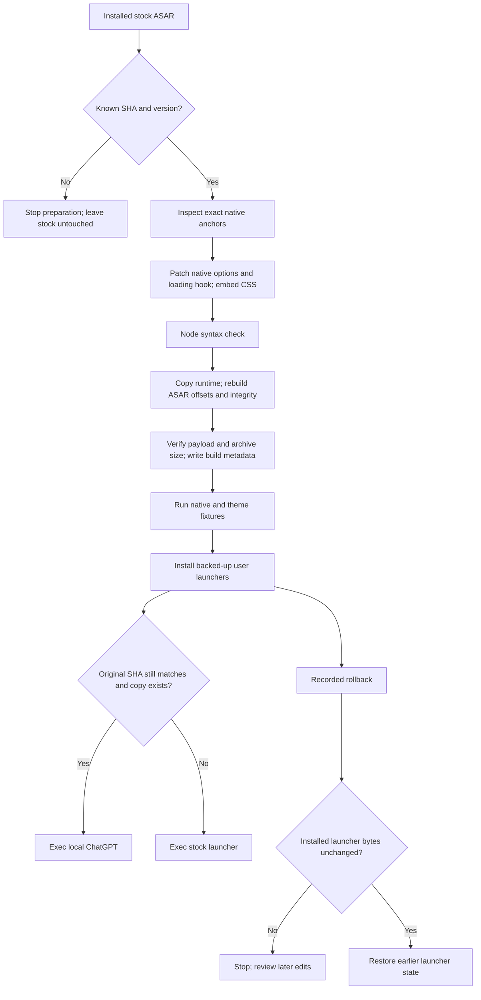
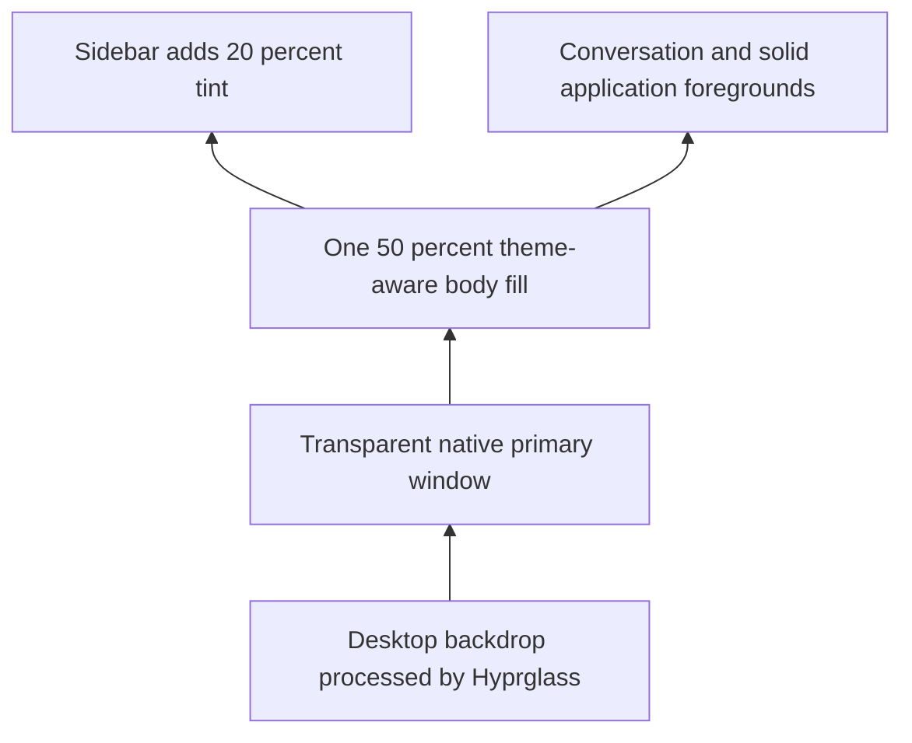

# Architecture and visual contract

Read [MAINTAINER.md](MAINTAINER.md) for installation, updates, validation, and recovery. This document explains why the patch exists and which behavior a port must preserve. Symbol names below describe the inspected **26.1111.21308** bundle; they are not stable APIs.

## 1. The three layers of glass

| Layer | Owner | Responsibility |
| --- | --- | --- |
| Native window | Electron main process | Create an alpha-capable surface with a transparent native background |
| Application material | `glass.css` injected into the primary renderer | Paint one theme-aware translucent base and a stronger sidebar, retaining normal foregrounds |
| Optical rendering | Hyprland with [Hyprglass Liquid](https://github.com/adenanteng/hyprglass-liquid) | Sample the backdrop, blur/refract it, and render the external glass rim |

Whole-window compositor opacity changes the final flattened texture, fading text, video, and icons together. This integration instead changes backgrounds before flattening. It does not need to classify pixels or infer which pixels belong to text.

The material is one 50% base: white in light mode and RGB `(36,36,36)` in dark mode. The sidebar adds a 20% light/dark tint. Where both cover the same pixel, their combined alpha is `1 - (1 - 0.50) * (1 - 0.20) = 0.60`. A 20% sidebar overlay is not a 20%-opaque final sidebar.

Opaque controls, menus, content cards, images, and video keep their application styling. Do not apply `opacity` to `body`, the root, or a compositor window rule to tune this material.

## 2. Repository map

| File | Role |
| --- | --- |
| [prepare.py](../prepare.py) | Version/fingerprint guard, native patch, CSS embedding, isolated copy, ASAR rebuild and verification |
| [glass.css](../glass.css) | Primary-window material and sidebar tint |
| [launch.sh](../launch.sh) | Original-archive guard and patched/stock executable selection |
| [install.py](../install.py) | Backup, launcher installation, desktop override, recovery helper and state |
| [rollback.py](../rollback.py) | Check installed bytes, restore baseline, retain recovery record |
| [rollback.sh](../rollback.sh) | Entry point to the installed Python recovery helper |
| [check-window.py](../check-window.py) | Execute actual extracted patched code with Electron stubs under Node |
| [check-theme.py](../check-theme.py) | Local browser fixture checking computed colors/opacity in both themes |

The ChatGPT theme fixture checks body/sidebar colors and one foreground span through light → dark → light. It does not currently contain a video or every control/wrapper. Solid media and secondary views remain live-validation requirements; Claude's larger fixture does not establish coverage here.

No npm install or third-party Python library is required. Node validates JavaScript and runs the native smoke fixture; Chrome is used only by the theme check. Application binaries are supplied by the system package, not this repository.

## 3. Build, installation, launch, and restoration



`prepare.py` is the build step. `install.py` changes launch routing; it does not patch the system package. `launch.sh` is the per-launch compatibility gate. `rollback.py` changes routing back; it does not remove the application profile or automatically delete the copied runtime.

The CSS is embedded as a JavaScript string in the copied ASAR. It is not read from the checkout on each launch. Editing a stylesheet or pulling a Git commit therefore needs preparation and a new application window; reinstalling unchanged launchers is unnecessary.

## 4. Current native patch points

System archive: `/usr/lib/chatgpt/resources/app.asar`.

`package.json` names `.vite/build/early-bootstrap.js` as the main entry. That bootstrap reaches the currently patched hashed bundle:

```text
.vite/build/early-bootstrap-226-2f6bd181558008cf.js
```

The patch uses exact strings and requires one match for each location:

| Anchor / symbol | Original purpose | Patch behavior |
| --- | --- | --- |
| `O=new eZ.BrowserWindow(M);` | Create the window using calculated options | Spread `M`, then override `transparent: true` and `backgroundColor: "#00000000"` only for Linux `u === "primary"` |
| `shouldAlwaysUseOpaqueWindowSurface(e){return` | Decide whether window appearance must remain opaque | Return false only for Linux primary appearance; retain the original policy for other cases |
| `let j=O.webContents;` | Obtain the new window's renderer | Add Linux-primary `did-finish-load` listener that calls `insertCSS` with `cssOrigin: "user"` |

Current meanings: `eZ` is the Electron alias, `M` the options, `u` the appearance identifier, `O` the window, and `j` its web contents. A future minifier can change all of them. Locate the semantic constructor/policy/hook again; do not reuse these letters by guesswork.

The transparent constructor alone is insufficient when the application still forces its opaque-surface policy. CSS alone is insufficient when the native surface remains opaque. All three changes are coordinated.

The primary-only scope is deliberate. Secondary windows retain their original options and do not receive the CSS listener. Background transparency for an embedded view or a new window type would be a separate inspected integration, not a reason to remove this scope guard.

`insertCSS` rejection is logged with a local-glass prefix. The patch does not change navigation, authentication, sandboxing, preload behavior, account logic, or the app's debugging policy. Preserve the order and behavior of surrounding native code during ports.

## 5. Renderer composition and themes



| CSS target | Why it exists |
| --- | --- |
| `html, body, #root` | Clear inherited/full-size application fills before assigning the one body base |
| `body` | Own the single 50% `light-dark()` base |
| `:root, [data-theme], .messaging-root` | Clear `--app-color-background-surface` and `--color-background-primary` structural fill variables |
| `:root, [data-theme], [data-codex-window-type], .messaging-root` | Clear `--app-color-background-shell` and `--app-shell-panel-background` |
| `[data-slate-sidebar-content]` | Apply the extra 20% navigation tint |

The app controls `color-scheme`. `light-dark()` follows that scheme, including system mode. Do not force the entire document to dark just to make transparency visible. When light-mode text changes but the background stays dark, inspect the computed scheme, owning background variables, and native surface rather than forcing foreground colors.

Selectors and CSS variables are application implementation details. Inspect rendered structure after application updates; a correct ASAR hash does not prove every UI state still uses these targets.

## 6. ASAR and build provenance

The patcher reads the pickle-prefixed ASAR header, walks the recursive file table, and modifies only the named main-process bundle. It streams other packed file data unchanged from original offsets. The modified entry's size, SHA-256, block hashes, and all packed offsets are recomputed before a temporary archive replaces the target.

The read-back check compares the embedded patched bundle bytes, its integrity hash, and total archive size. `build-info.json` records the application version, original and patched archive fingerprints, and modified file list. This does not bypass signatures or guarantee compatibility with future binary-level integrity enforcement.

See [ASAR-INSPECTION.md](ASAR-INSPECTION.md) for a read-only extraction recipe. Never patch `/usr/lib/chatgpt` in place or publish the extracted proprietary bundle.

## 7. Guard boundaries

| Mechanism | Protects against | Does not prove |
| --- | --- | --- |
| Exact source SHA | Silently patching an unreviewed installed package | UI correctness or unchanged external services |
| Internal version and one-match anchors | Wrong layout/ambiguous replacement | Semantic correctness of newly selected anchors |
| Node syntax check | Invalid generated JavaScript | Real Electron lifecycle/security behavior |
| `/proc` target executable guard | Rebuilding the exact copied executable while visibly running in the inspected namespace | Termination of processes hidden by another namespace |
| ASAR read-back/integrity | Wrong payload/offset/hash for the modified archive layout | A complete valid app directory after an interrupted earlier copy |
| Launcher source guard | Using a stale patch after the system archive changed | Patched archive integrity on every launch |
| Rollback checksums | Overwriting later edits to recorded existing destinations | Recovery from missing state/backups or a fully atomic multi-file transaction |

The installer is conventional-home oriented and does not explicitly reject destination symlinks. A symlink backup may preserve target contents rather than the original link. Review this before installing on a new setup; the current test coverage is not a universal installer guarantee.

## 8. Design history and regressions to retain

| Observed issue | Lesson retained |
| --- | --- |
| Whole-window opacity faded writing and video | Change alpha only on backgrounds before compositing |
| Fully transparent application looked too empty | Use a 50% base and distinguish the sidebar |
| Light theme kept a dark material | Follow the app's scheme instead of hardcoded dark background |
| Update removed the visible patch | Source fingerprint fallback is intentional; port the native anchors and prepare a new copy |
| Syntax-valid native changes could target stale identifiers | Execute the extracted current functions with stub windows, then inspect the real app separately |
| Active conversation hosted by the app | Do not terminate the user's work to claim a live restart; report it pending |

Packages previously supported included `26.1013.40934` and `26.1029.61003`; their hashed paths and patch anchors are historical. Current prepared support is `26.1111.21308`. The recorded November 15 update passed native/archive/theme checks, while full quit/reopen of the stock instance and live visual validation remained pending. These statements are evidence boundaries, not a claim about whatever process is running now.

## 9. A successful continuation

A maintainer can explain which layer paints a problem, inspect a new package without changing it, adapt the exact native hooks, preserve foreground and security behavior, validate the real rebuilt payload, install with a recoverable baseline, and distinguish fixture success from actual visual verification. The operational steps and completion report are in [MAINTAINER.md](MAINTAINER.md).
